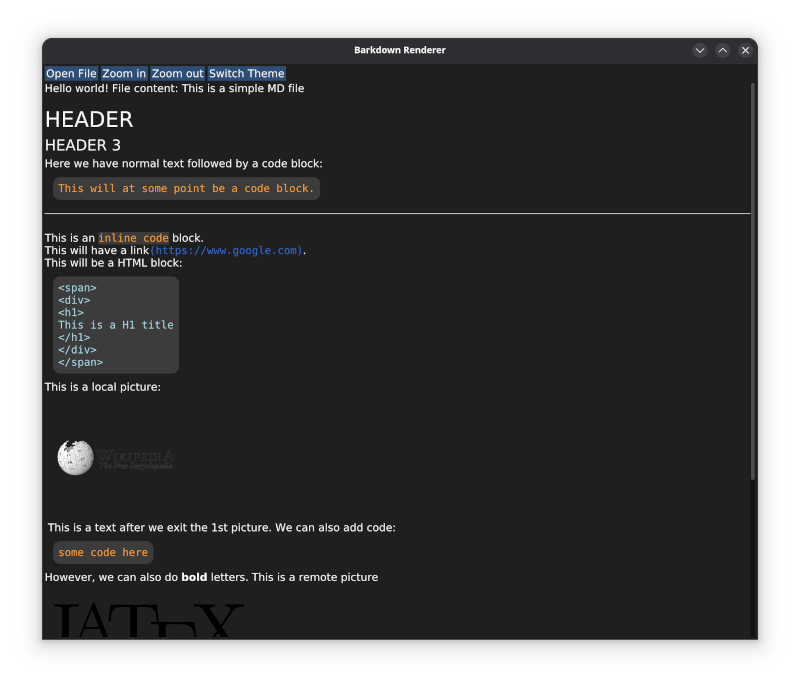

# Barkdown: a simple, fast Markdown renderer
Barkdown is a simple Markdown reader designed for quick and easy viewing of Markdown documents. Currently, to view documents in Markdown, one is forced to use a browser or an application that basically loads a browser to render Markdown first in HTML and then to view that HTML on the screen.

Barkdown was written to simplify the process as much as possible. It uses `cmark` to parse the document and identify the nodes. These are then rendered out in an `SDL2` window, enriched with `ImGUI` elements and accelerated by `OpenGL` to provide a nice scrolling experience.

Capabilities:
- fully accelerated `OpenGL` window
- supports all official CMark nodes including rendering of both local and remote images
- multi-threaded fetching of images for big `Markdown` documents.
- customized rendering engine which directly renders the document without calling expensive 3rd party libraries (wrap sensitive)
- minimalistic `ImGui` interface
- dark and light theme switchable via a GUI button.

## Installation
### Compiling from source
1. Clone the git repository:

   ~~~
   $ git clone https://github.com/ibazulic/barkdown.git
   ~~~

2. Install dependencies:

   - for RHEL/Fedora based distributions:
    
     ~~~
     $ sudo dnf install SDL2-devel libcurl-devel cmark-devel stb_image-devel mesa-libGL cmake
     $ sudo dnf group install c-development
     ~~~
    
   - for Debian based distributions:
        
     ~~~
     $ sudo apt-get install libsdl2-dev libcurl4-openssl-dev libcmark0.30.2 libcmark-dev libgl1-mesa-dev cmark libstb-dev build-essential cmake 
     ~~~

3. Building cannot be done from the source dir, I'd just recommend creating `build` directory inside:

   ~~~
   $ cd barkdown && mkdir build && cd build
   $ cmake ..
   $ make
   $ make install
   ~~~

The binary should land in your `/usr/local/bin` directory.

### Use a pre-built package
Compiling from source can be tricky as it requires a bunch of libraries. So it's much better to just go to the `Releases` page and download the pre-compiled package for your operating system:

- for RHEL/Fedora based distributions:

  ~~~
  $ sudo dnf install /path/to/barkdown.rpm
  ~~~

- For Debian/Ubuntu based distributions:
  
  ~~~
  $ sudo apt install /path/to/barkdown.deb
  ~~~

# Contributing
All contributions and improvements to the project are more than welcome.

# Screenshot

# Known issues
Current known issues are cosmetical in nature:

- spacing between certain nodes is not as it should be (duplicate rows)
- rendered pictures should move closer to the left side of the screen as the rendering area shrinks.
- missing `About` screen in the GUI (to be honest, it never occurred to me to actually put it in there ;-))
